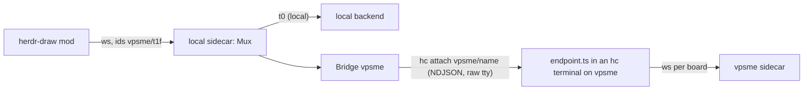

# src/bridge: boards on other machines

The local sidecar (the relay) reaches each remote machine's backend through one pipe per machine.
Spike results and the reasoning are in PLAN.md, step 7.



## The link

- **Default: an hc terminal stream** (`hcLinkArgv` run with `spawnPty`).
  - `hc run --on <m> --bg --rm --name <n>` starts the endpoint with its tty raw; then `hc attach
    <m>/<n>` runs under a Bun pseudo-terminal.
  - It uses hc's own machine link, so users configure nothing, and it works for ssh and `--via`
    machines.
  - The endpoint outlives dropped links, and hc resumes the stream after it re-dials.
  - `<n>` must be unique per local core: two relays on one endpoint would mix their input.
- **Fallback: an ssh stdio pipe** (`linkArgv` run with `spawnLink`). It is built from the
  `hc machine ls --json` entry: `ssh -T -o BatchMode=yes -o ServerAliveInterval=5 <target>`, or
  `<via command> '<line>'`.
- **Not a stream: `hc exec --on <m> -i`.** It reads stdin to EOF and returns output at exit, with a
  600 s cap. Use it for one-shot calls, such as starting the remote backend.

A terminal stream needs three guards, all handled by `Bridge` and the parsers:
- On attach and resume, hc repaints the screen, so old frames come back. Frames before the pong to
  the link's first ping are ignored, and repeated sequence numbers are dropped.
- Escape bytes can precede a line, so parsing starts at the first `{`.
- Frames sent while hc re-dials (1-4 s) are lost. A sequence gap makes the receiver ask for full
  state, so the scene stays consistent; a lost op is not re-sent (follow-up: acks and resend).

## Modules

| File          | What                                                                                                                                     |
| ------------- | ---------------------------------------------------------------------------------------------------------------------------------------- |
| `protocol.ts` | Frames, board id helpers (`splitBoardId`, `qualify`), pin messages, frame parsers (trust boundary)                                       |
| `ndjson.ts`   | `encode`, `LineDecoder` (chunk/UTF-8 safe, drops lines over 32 MB), `readLines`                                                          |
| `coalesce.ts` | `Coalescer`: merges one board's pending server messages; same result as applying them in order                                           |
| `bridge.ts`   | `Backend` interface; `Bridge` (one per machine); `Mux` (routes `machine/board` ids); `spawnPty` + `hcLinkArgv`, `spawnLink` + `linkArgv` |
| `endpoint.ts` | Remote end: `runEndpoint` relays frames to the machine's sidecar (`wsConnect`, one websocket per board)                                  |
| `clock.ts`    | Injectable time for tests                                                                                                                |

How `Bridge` behaves:
- It spawns the link on the first subscribe and closes it after the last unsubscribe.
- It pings every 5 s and kills the link after 15 s of silence.
- It numbers its frames per link (`n`). A repeat from the backend is dropped, and a gap resubscribes
  every board. The endpoint does the same for the relay's frames by reopening its boards.
- It reconnects with backoff from 500 ms, doubling up to 30 s.
- On reconnect it re-subscribes every board; each backend answers with full state.
- While the link is down, ops, undo and redo queue and are sent once it is back. Previews are
  dropped. Every board gets a `status: disconnected` message.

How the endpoint behaves:
- It exits on stdin EOF, or after 20 s without frames (a hung link sends no EOF).
- It merges board messages while the pipe is busy. Ops are never merged: each batch is one undo
  step.

## Protocol proposal (hd-jf3.7.2)

```ts
type DownFrame = { n?: number } & (
  | { kind: "board"; board: string; msg: ServerMessage | PinMessage }
  | { kind: "pong"; t: number }
);
type UpFrame = { n?: number } & (
  | { kind: "board"; board: string; msg: ClientMessage | { type: "subscribe" | "unsubscribe" } }
  | { kind: "ping"; t: number }
);
type PinMessage = { type: "pins"; pins: Pin[] } | { type: "pin"; pin: Pin } | { type: "unpin"; id: string };
```

- On the wire to a machine, board ids are local to it (`t1f`); `Mux` adds and strips the machine
  prefix. A backend never needs to know its own name.
- `subscribe` asks for full state (status, scene, history, pins), then changes.
- Pins carry the rendered SVG plus the Mermaid source, so the frontend never reads remote files.

What has to change at integration (owned by the sidecar and protocol work):
1. `src/canvas/protocol.ts`:
   - Add `PinMessage`, `subscribe` and `unsubscribe`.
   - Tag mod websocket messages with `board` (the `kind: "board"` frame works as is), so local
     and remote share one path.
   - Then `src/bridge/protocol.ts` imports from it instead of defining its own.
2. Sidecar as backend: the endpoint's `Connect` is the seam. `wsConnect` assumes one websocket
   per board (`ws://127.0.0.1:$CANVAS_SIDECAR_PORT/b/{board}/ws`, the endpoint's first argument).
   If the multi-board sidecar has a single mod websocket carrying `{board, msg}`, swap in a
   `Connect` that shares one socket and forwards `kind: "board"` frames almost unchanged.
3. Sidecar as relay:
   - Wrap its in-process boards as a `Backend`.
   - Build
     `new Mux(local, m => new Bridge({ machine: m, argv: hcLinkArgv(m, name, line), spawn: spawnPty }))`.
   - `name` is unique per local core (for example `hd-<core name>`); the ssh fallback is
     `argv: linkArgv(entry, line)`.
   - Refuse a machine name not in `hc machine ls`: the prefix comes from the mod.
   - Route mod subscriptions and ops through it.
4. Remote install (hd-jf3.7.4):
   - Bundle the endpoint with `bun build src/bridge/endpoint.ts --target bun`.
   - Put it on the machine with `hc file write --on`.
   - `line` is `bun <path> '<ws template>'` (vpsme: `/usr/local/bin/bun`).
