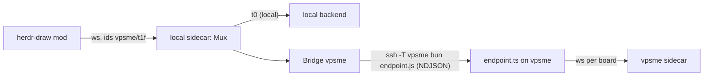

# src/bridge: boards on other machines

The local sidecar (the relay) reaches each remote machine's backend through one pipe per machine.
Spike results and the reasoning are in PLAN.md, step 7.



## Why not `hc exec --on <m> -i`

The task asked for it, but `hc exec` is batch-only. It reads stdin to EOF, runs the program, and
returns the output when the program exits. Its timeout is 60 s by default and at most 600 s. The
bridge instead runs the machine's own link as a pipe: `ssh -T -o BatchMode=yes <target> <line>`
for ssh machines, or `<via command> '<line>'` for `--via` machines. `linkArgv` builds it from an
`hc machine ls --json` entry. `hc exec` still suits one-shot calls (install, status).

## Modules

| File          | What                                                                                                         |
| ------------- | ------------------------------------------------------------------------------------------------------------ |
| `protocol.ts` | Frames, board id helpers (`splitBoardId`, `qualify`), pin messages, frame parsers (trust boundary)           |
| `ndjson.ts`   | `encode`, `LineDecoder` (chunk/UTF-8 safe, drops lines over 32 MB), `readLines`                              |
| `coalesce.ts` | `Coalescer`: merges one board's pending server messages; same result as applying them in order               |
| `bridge.ts`   | `Backend` interface; `Bridge` (one per machine); `Mux` (routes `machine/board` ids); `spawnLink`, `linkArgv` |
| `endpoint.ts` | Remote end: `runEndpoint` relays frames to the machine's sidecar (`wsConnect`, one websocket per board)      |
| `clock.ts`    | Injectable time for tests                                                                                    |

How `Bridge` behaves:
- It spawns the link on the first subscribe and closes it after the last unsubscribe.
- It pings every 5 s and kills the link after 15 s of silence.
- It reconnects with backoff from 500 ms, doubling up to 30 s.
- On reconnect it re-subscribes every board; each backend answers with full state.
- While the link is down, ops, undo and redo queue and are sent once it is back. Previews are
  dropped. Every board gets a `status: disconnected` message.

How the endpoint behaves:
- It exits on stdin EOF, or after 20 s without frames (a hung link sends no EOF).
- It merges board messages while the pipe is busy. Ops are never merged: each batch is one undo
  step.

## Protocol proposal (hd-jf3.7.2)

```ts
type DownFrame = { kind: "board"; board: string; msg: ServerMessage | PinMessage } | { kind: "pong"; t: number };
type UpFrame =
  | { kind: "board"; board: string; msg: ClientMessage | { type: "subscribe" | "unsubscribe" } }
  | { kind: "ping"; t: number };
type PinMessage = { type: "pins"; pins: Pin[] } | { type: "pin"; pin: Pin } | { type: "unpin"; id: string };
```

- On the wire to a machine, board ids are local to it (`t1f`); `Mux` adds and strips the machine
  prefix. A backend never needs to know its own name.
- `subscribe` asks for full state (status, scene, history, pins), then changes.
- Pins carry the rendered SVG plus the Mermaid source, so the frontend never reads remote files.

What has to change at integration (owned by the sidecar and protocol work):
1. `src/canvas/protocol.ts`:
   - Add `PinMessage`, `subscribe` and `unsubscribe`.
   - Tag mod websocket messages with `board` (the `kind: "board"` frame works as is), so local
     and remote share one path.
   - Then `src/bridge/protocol.ts` imports from it instead of defining its own.
2. Sidecar as backend: the endpoint's `Connect` is the seam. `wsConnect` assumes one websocket
   per board (`ws://127.0.0.1:$CANVAS_SIDECAR_PORT/b/{board}/ws`, the endpoint's first argument).
   If the multi-board sidecar has a single mod websocket carrying `{board, msg}`, swap in a
   `Connect` that shares one socket and forwards `kind: "board"` frames almost unchanged.
3. Sidecar as relay:
   - Wrap its in-process boards as a `Backend`.
   - Build `new Mux(local, m => new Bridge({ machine: m, argv: linkArgv(entry, line) }))`, with
     `entry` from `hc machine ls --json`.
   - Refuse a machine name not in that list. The prefix comes from the mod and must never reach
     ssh unchecked.
   - Route mod subscriptions and ops through it.
4. Remote install (hd-jf3.7.4):
   - Bundle the endpoint with `bun build src/bridge/endpoint.ts --target bun`.
   - Put it on the machine with `hc file write --on`.
   - Run it with `exec bun <path>` (vpsme: `/usr/local/bin/bun`, which non-interactive ssh has on
     PATH).
